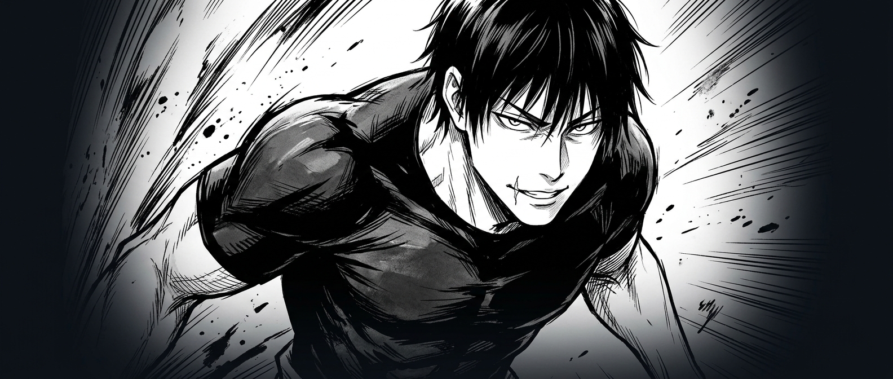

  

 

<h2 align="center">
  ʟᴜᴄᴀs ᴍᴇʟᴏ
</h2>

  
  

<table>
  <tr>
    <td width="28%" align="center" valign="middle">
      
    </td>
    <td width="72%" valign="middle">
      <h3>
        
        &nbsp; ᴀʙᴏᴜᴛ ᴍᴇ
      </h3>
      <ul>
        <li><strong>Name:</strong> <code>Lucas Melo</code></li>
        <li><strong>Role:</strong> <code>Full-Stack Developer</code></li>
        <li><strong>Education:</strong> <code>Systems Analysis and Development</code></li>
        <li><strong>Off the clock:</strong> <code>Video Editing & Minimalist Graphic Design</code></li>
      </ul>
       
      <h3>
        
        &nbsp; sᴛᴀᴄᴋ
      </h3>
      

        
      

    </td>
  </tr>
</table>
